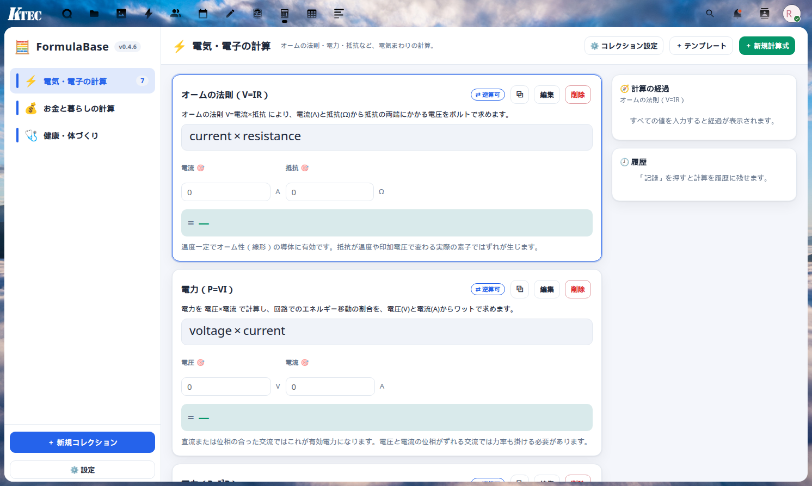
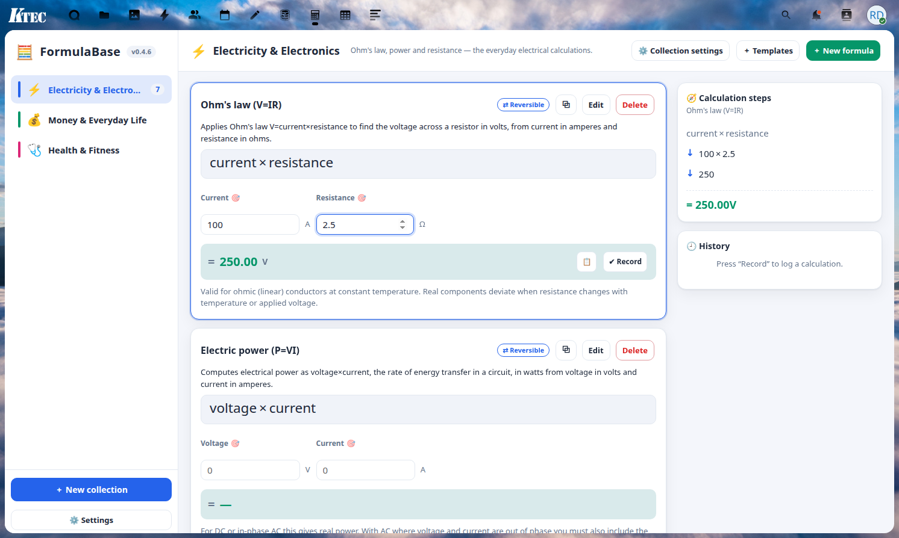
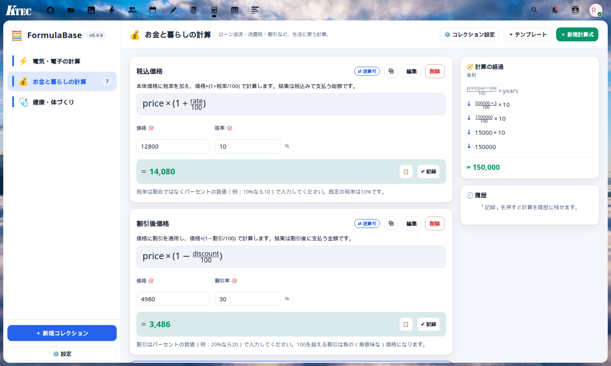
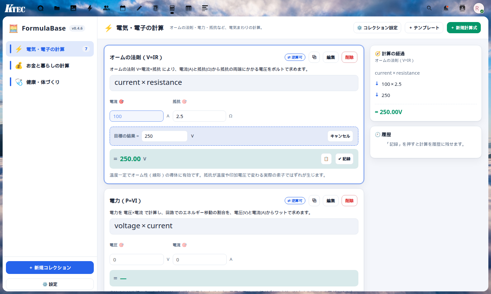
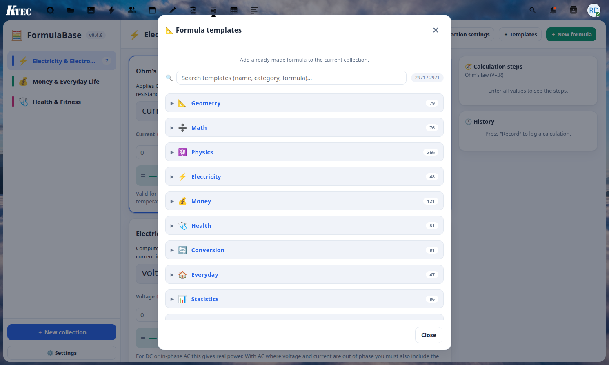
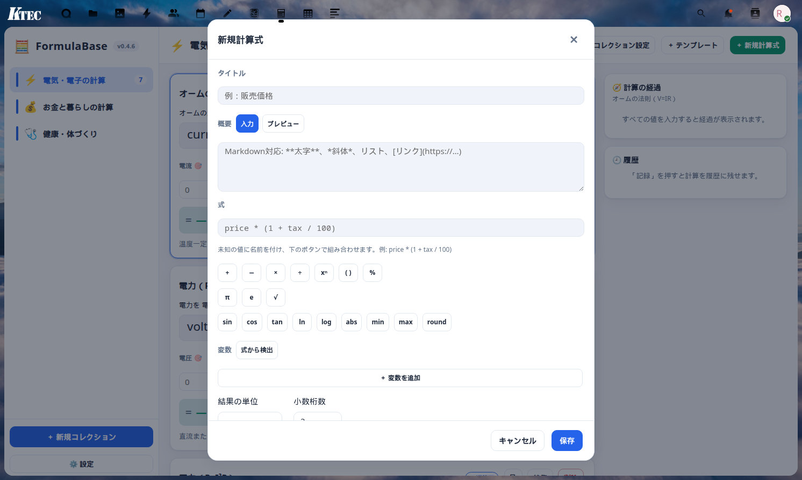
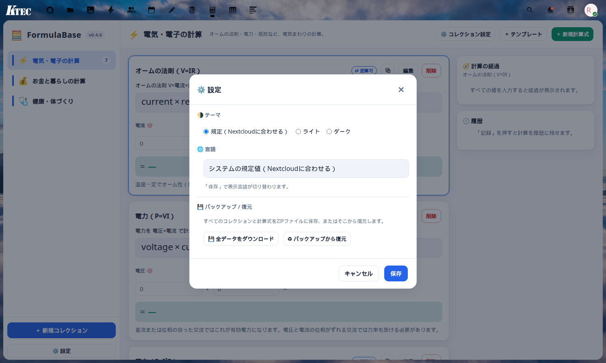
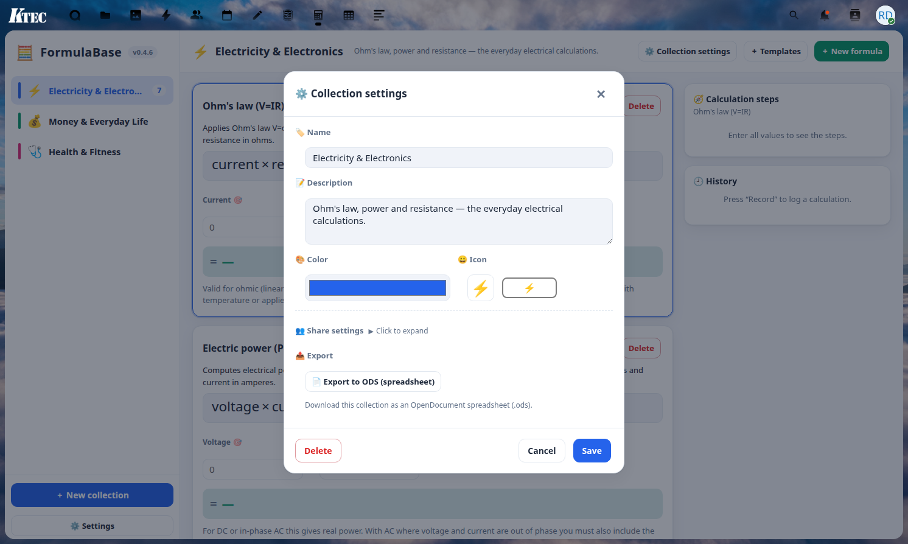

# FormulaBase 🧮

**Save your own formulas, type in numbers, and calculate instantly — a personal calculator app for Nextcloud, with 5,522 built-in formula templates to get you started.**
**よく使う計算式を登録しておけば、数値を入力するだけですぐに計算できる、Nextcloud 用の個人向け計算アプリです。すぐに使える計算式テンプレートを 5,522 件収録しています。**

> Personal project · self-hosted · runs entirely inside your own Nextcloud.
> 個人プロジェクト · セルフホスト型 · お使いの Nextcloud の中だけで動作します。

[English ↓](#english) · [日本語 ↓](#japanese)

---

## English

FormulaBase is a lightweight personal calculator for the formulas you use again and again — markups, unit conversions, loan payments, mixing ratios, engineering constants, anything.

Organise your formulas into **collections**, define each formula's **variables** once, then open it any time, type in numbers, and read the result **live**. A right-hand panel shows the **step-by-step calculation** (values substituted in, then reduced one operation at a time), and every calculation you press **Record** on is kept in a per-formula **history** stored on the server.

### Why FormulaBase

- **You don't start from a blank page.** FormulaBase ships with **5,522 ready-made formula templates in 13 fields** — mathematics, statistics and probability, AI and computing, physics, space and Earth, chemistry and materials, engineering, personal money, investing and markets, business and accounting, economics, health and life sciences, and everyday life. The list is grouped by field, related fields sit side by side, and **Template settings** lets you hide whole fields, subcategories or single templates you never use. Search the library, drop a template straight into your own collection, and start calculating — no need to type out the formula yourself.
- **Nothing leaves your browser.** The expression engine is a small hand-written parser/AST evaluator — **no `eval`, no `new Function`, no `unsafe-eval`**. Every calculation runs client-side, instantly, with no round-trip to the server and no code-injection surface.
- **You can see the math, not just the answer.** The step-by-step trace panel substitutes your values into the formula and reduces it one operation at a time, so you (or a student, or a colleague) can follow exactly how the result was reached.
- **Your work is never lost.** Every formula keeps its own calculation history on the server — record a calculation, restore it later, delete what you don't need, scoped per user. Edits to a formula itself are protected too: the version before each edit is kept beside it, numbered and restorable, so a bad edit is never the end of the story.
- **Built for teams, not just individuals.** Share a collection with other Nextcloud users at three permission levels (view / edit / delete), so a department can maintain one shared set of formulas instead of everyone reinventing them.
- **Speaks your language.** Every screen and all 5,522 templates are available in 13 languages — English, Japanese, Chinese, Spanish, French, German, Italian, Portuguese (Brazil and Portugal), Russian, Arabic, Hindi and Korean — with full technical/scientific terminology, not just menu labels.

### Features
- **5,522 built-in formula templates in 13 fields**, grouped by field — searchable and ready to drop into your own collections
- **Template settings** — hide whole fields, subcategories or single templates; hidden ones never appear in the list, in search or in the counts
- Collections of reusable formulas
- Named variables with labels, units and default values — numbers, lists, matrices or complex numbers
- **Safe expression engine** — a small parser/AST evaluator, **no `eval` / no `new Function`** (no `unsafe-eval`), with **more than 200 functions**: arithmetic, comparisons and conditions (`if`, `piecewise`), sums and products (Σ, Π), definite integrals, derivatives and equation solving (`solve`), statistics, cash flows (`npv`, `irr`), vectors and matrices, exact whole-number arithmetic for number theory (`gcd`, `isprime`, `powmod`, …), special functions, probability distributions and physical constants. A function list with short descriptions opens from the formula editor. Unicode (incl. Japanese) variable names supported.
- **Live result** as you type, with unit and decimal-place control
- **Step-by-step trace** of the calculation — one Output button copies it as text or as an image, or saves it into your Nextcloud Files in your choice of format: Markdown, a real calculable ODS spreadsheet, or an ODT report
- **Server-side history** per formula (record / restore / delete / clear), scoped per user
- **Version history** per formula — the version before each edit is kept beside it (numbered, restorable), independent of the calculation history above; how many to keep, and whether one is taken on every edit or only on request, is configurable in Settings
- **Internal sharing** — share a collection with other Nextcloud users at three permission levels (view / edit / delete)
- **An AI assistant, through the AI-Hub app** — a chat beside the formulas that knows FormulaBase and how its expressions are written; it answers in words and writes a formula out as text you can type in, reads the open collection only as the administrator allows, and changes nothing. It needs the free **AI-Hub** app, where the AI service, its key and its limits are set once for every app on the server; without it, it is simply not shown
- UI and template library in 13 languages — English, Japanese, Chinese, Spanish, French, German, Italian, Portuguese (Brazil and Portugal), Russian, Arabic, Hindi and Korean

### Tech
Buildless Vue 3 (Options API). The template is precompiled to an eval-free render function (`formulabase-build.mjs` using `@vue/compiler-dom`); the runtime loads `vue.runtime.global.prod.js` + `formulabase.dist.js`. Backend: Nextcloud AppFramework (PHP), three tables (`formulabase_colls`, `formulabase_formulas`, `formulabase_history`).

Requires Nextcloud 30–35.

### Help us test the template library

Thank you for the downloads and the kind comments on apps.nextcloud.com. No problems were reported up to 0.6.2, so 0.7.0 added 2,400 formulas (5,522 in all) and many new functions, without changing how you use the app. 0.8.0 translates those additions into every language, and adds Brazilian Portuguese.

I have not tried every formula myself, so your reports matter a great deal to me. If you find a mistake, please tell me in the [FormulaBase 0.7.0 thread](https://help.nextcloud.com/t/formulabase-0-7-0-2-400-new-formula-templates-help-testing-them-is-very-welcome/249798) on help.nextcloud.com or [open a GitHub issue](https://github.com/ktec-nc-apps/FormulaBase/issues/new?template=formula-report.yml) — even one line helps.

I hope the apps I make bring a little happiness to as many people as possible.

---

## 日本語

FormulaBase は、利益率の計算、単位換算、ローンの返済額、配合比、工学の定数など、何度も使う計算式を登録しておける軽量な個人向け計算アプリです。

計算式を**コレクション**にまとめ、それぞれの式の**変数**を一度定義しておけば、あとはいつでも式を開いて数値を入力するだけで、結果が**リアルタイム**で表示されます。画面の右側には**計算の経過**（数値を代入し、1 つずつ計算を進めていく様子）が表示されます。「**記録**」を押した計算は、計算式ごとの**履歴**としてサーバーに保存されます。

### FormulaBase の特長

- **一から式を作る必要はありません。** 数学、統計と確率、AI とコンピューター、物理、宇宙と地球、化学と材料、工学、暮らしのお金、投資と市場、会社の会計と経営、経済学、医療と生命科学、暮らしの **13 分野・5,522 件の計算式テンプレート**を最初から収録しています。一覧は分野ごとに分かれ、関連する分野が隣り合うように並んでいます。使わない分野、小分類、個々のテンプレートは、**テンプレート設定**で非表示にできます。ライブラリを検索してテンプレートを自分のコレクションに追加すれば、式を自分で入力しなくても、すぐに計算を始められます。
- **計算はすべてブラウザー内で完結します。** 数式エンジンは独自に作成した小さなパーサー／AST 評価器で、**`eval` や `new Function` は一切使っていません**（`unsafe-eval` も不要です）。計算はすべてブラウザー側ですぐに実行され、サーバーとの通信は発生せず、コードインジェクションの余地もありません。
- **答えだけでなく、計算の過程も確認できます。** 計算の経過パネルには、入力した値を式に代入し、1 つずつ計算を進めていく様子が表示されます。結果に至るまでの流れを、ご自身はもちろん、学生や同僚もそのまま追うことができます。
- **作業が失われることはありません。** 計算式ごとに計算履歴をサーバーに保存でき、記録した計算を後から復元したり、不要なものを削除したりできます（履歴はユーザーごとに別々です）。計算式そのものの編集も保護されています。編集するたびに直前の内容が番号付きで残り、いつでも復元できるので、編集を誤っても元に戻せます。
- **個人だけでなく、チームでも使えます。** コレクションを他の Nextcloud ユーザーと 3 段階の権限（閲覧／編集／削除）で共有できるので、部署で 1 つの計算式集を共同で管理できます。一人ひとりが同じ式を作り直す必要はありません。
- **多言語に対応しています。** すべての画面と 5,522 件のテンプレートが、英語、日本語、中国語、スペイン語、フランス語、ドイツ語、イタリア語、ポルトガル語（ブラジル・ポルトガル）、ロシア語、アラビア語、ヒンディー語、韓国語の 13 言語に対応しています。メニューだけでなく、技術・科学の専門用語まで翻訳しています。

### 主な機能
- **13 分野・5,522 件の組み込み計算式テンプレート**（分野ごとに分けて表示）— 検索して、そのまま自分のコレクションに追加できます
- **テンプレート設定** — 分野、小分類、テンプレート単位で非表示にできます。非表示にしたものは、一覧にも検索結果にも件数にも表示されません
- 繰り返し使える計算式をコレクションで管理
- ラベル、単位、初期値を設定できる名前付きの変数 — 数値、リスト、行列、複素数に対応
- **安全な数式エンジン** — 小さなパーサー／AST 評価器で、**`eval` も `new Function` も使いません**（`unsafe-eval` 不要）。**200 を超える関数**を備えています：四則演算、比較と条件分岐（`if`・`piecewise`）、総和・総乗（Σ・Π）、定積分、微分、方程式の求解（`solve`）、統計、キャッシュフロー（`npv`・`irr`）、ベクトルと行列、数論向けの正確な整数演算（`gcd`・`isprime`・`powmod` など）、特殊関数、確率分布、物理定数。関数の一覧と簡単な説明は、計算式エディターから開けます。変数名には日本語などの Unicode 文字も使えます
- 入力に合わせて**結果をリアルタイムに表示**（単位と小数点以下の桁数を指定可能）
- **計算の経過を表示** — 「出力」ボタンから、テキストまたは画像としてコピーしたり、Markdown、実際に計算できる ODS スプレッドシート、ODT レポートのいずれかの形式で Nextcloud の Files に保存したりできます
- 計算式ごとに**計算履歴をサーバーに保存**（記録／復元／削除／全消去。ユーザーごとに独立）
- **バージョン履歴** — 計算式を編集するたびに直前の内容を番号付きで保存し、いつでも復元できます。上記の計算履歴とは別の機能です。保存する数と、編集のたびに自動で保存するか指定したときだけ保存するかは、設定で変更できます
- **内部共有** — コレクションを他の Nextcloud ユーザーと 3 段階の権限（閲覧／編集／削除）で共有
- **AI-Hub アプリを通じた AI アシスタント** — 計算式の横にチャットを表示します。FormulaBase と計算式の書き方を理解しており、質問に文章で答え、計算式はそのまま入力できるテキストとして示します。開いているコレクションは管理者が許可した範囲でのみ読み取り、データを変更することはありません。利用には無料の **AI-Hub** アプリが必要です。AI サービスとそのキー、利用制限は AI-Hub で一度設定すれば、サーバー上のすべてのアプリで共通して使われます。AI-Hub がない場合は表示されません
- 画面とテンプレートライブラリは 13 言語に対応 — 日本語、英語、中国語、スペイン語、フランス語、ドイツ語、イタリア語、ポルトガル語（ブラジル・ポルトガル）、ロシア語、アラビア語、ヒンディー語、韓国語

Nextcloud 30〜35 に対応しています。

### テンプレートの動作確認にご協力ください

たくさんのダウンロードと、apps.nextcloud.com での温かいコメントをありがとうございます。0.6.2 までは問題の報告がなかったため、0.7.0 では使い方を変えずに、計算式を 2,400 件（合計 5,522 件）と多数の関数を追加しました。0.8.0 では、追加分をすべての言語に翻訳し、ポルトガル語（ブラジル）にも対応しました。

私自身がすべての計算式を試したわけではないため、皆さまからのご報告がとても大切です。誤りを見つけたら、help.nextcloud.com の [FormulaBase 0.7.0 のスレッド](https://help.nextcloud.com/t/formulabase-0-7-0-2-400-new-formula-templates-help-testing-them-is-very-welcome/249798)か、[GitHub の Issue](https://github.com/ktec-nc-apps/FormulaBase/issues/new?template=formula-report.yml)でお知らせください。一行だけでも助かります。

私の作るアプリが、一人でも多くの方にとって小さな幸せになれば幸いです。

---

## Screenshots

| | |
|---|---|
|  |  |
| Formula list / 計算式一覧 | Calculation / 計算 |
|  |  |
| Money results / 金額の計算結果 | Reverse solve / 逆算 |
|  |  |
| Templates / テンプレート | Formula editor / 計算式エディター |
|  |  |
| Settings / 設定 | Collection settings / コレクション設定 |

## License
[AGPL-3.0](LICENSE) · © KTEC
